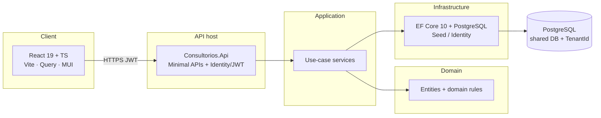
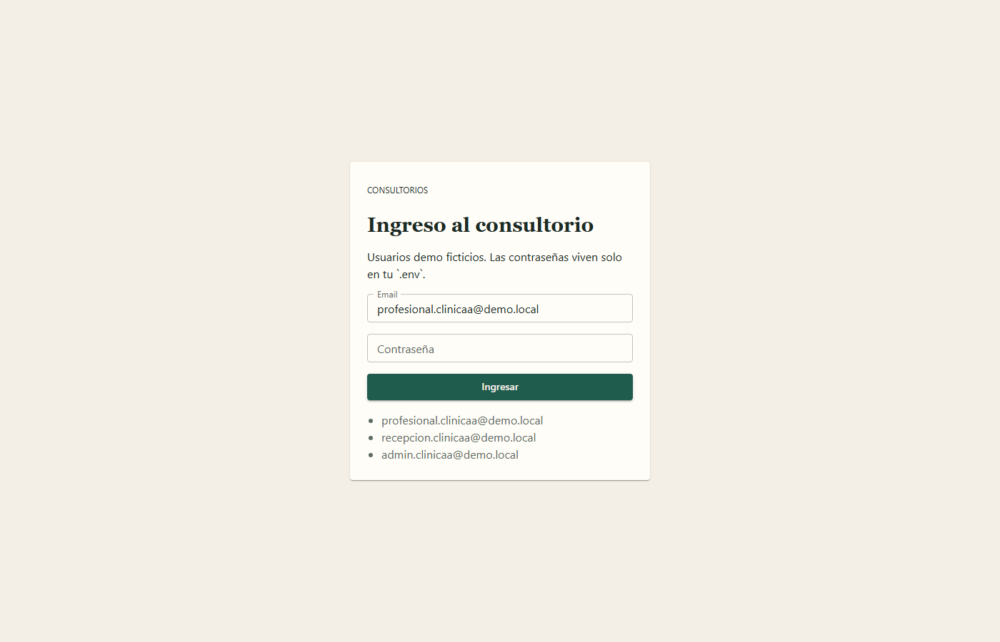
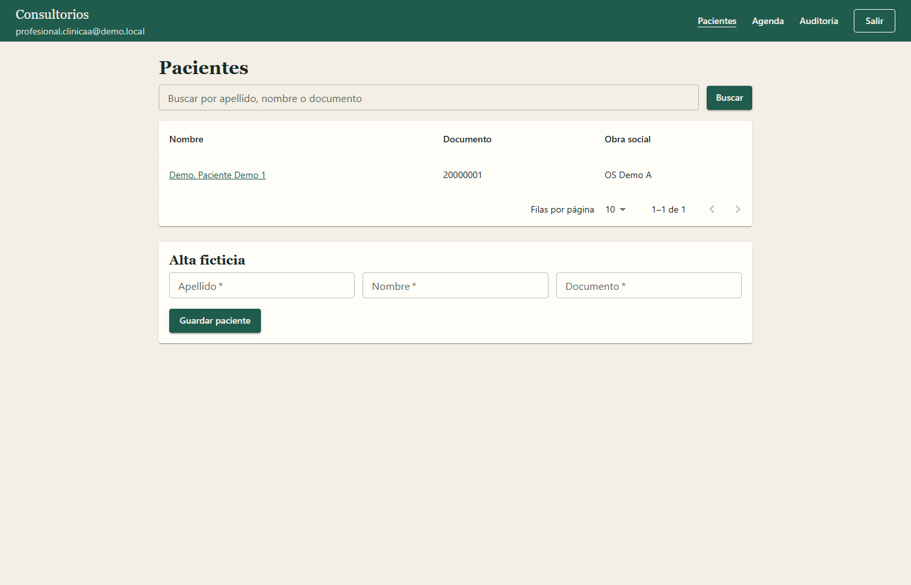
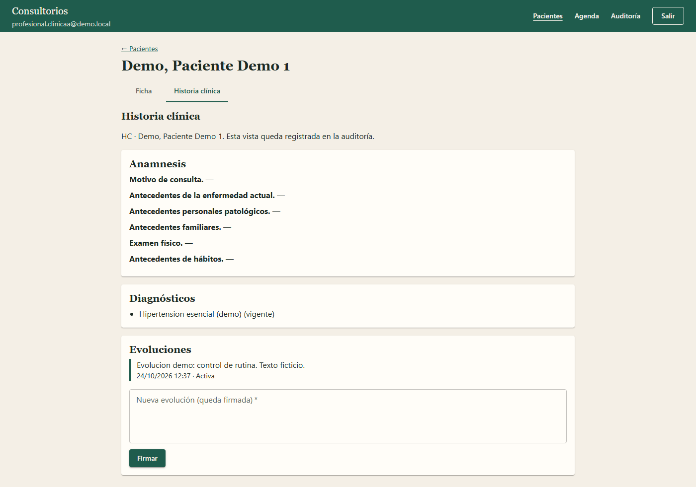

# Consultorios Modernization

[](https://github.com/rambmario/consultorios-modernization/actions/workflows/ci.yml)
[](https://dotnet.microsoft.com/)
[](https://react.dev/)
[](LICENSE)

Modernization of **Consultorios**, a legacy clinical-records system I designed and maintained at Ingesoft, into a multi-tenant .NET 10 + React platform.

This repository is **greenfield documentation and code only**. The original desktop system is treated as read-only analysis input and is never copied here.

---

## Privacy

This is health software (clinical records). The repo must never contain:

- Real patient, professional, or clinic data (names, national IDs, addresses, phones, diagnoses, treatments, attachments, images).
- Database backups (`.bak`, `.mdf`, `.ldf`) or connection strings / credentials.

Seeds and screenshots use obviously fictitious data only (e.g. `Paciente Demo 1`, `ClinicaA`, `ProfesionalA`).

---

## Context

Consultorios started as a **VB.NET WinForms** desktop app for a single clinic. The new product is a **multi-tenant** clinical platform (one shared PostgreSQL database, `TenantId` on every clinic-owned row) aimed at more than one professional, with roles **Admin**, **Profesional**, and **Recepción**.

The goal is not a big-bang rewrite of every leftover in the old tree. Phase 1 ships a clean vertical slice — login, patient file, signed progress notes, appointment agenda, and clinical-record audit — that can grow after a public AWS demo (Phase 2). Real clinical data is never migrated.

---

## What it does

Phase 1 delivers the **clinical MVP**:

- **Login** with ASP.NET Identity + JWT (`tenant_id` claim), rate-limited, fail-closed across tenants.
- **Patient file**: demographics, coverage (health-plan name + affiliation number), address.
- **Clinical record** (Profesional only): structured anamnesis with **long Spanish section names**, diagnosis history, and **signed progress notes** (only the signer can cancel or correct).
- **Appointment agenda** (built from scratch) with a PostgreSQL exclusion constraint so one professional cannot have overlapping occupying slots.
- **Append-only audit** of who viewed or changed a clinical record, and when.
- Spanish React UI (Vite, TanStack Query, MUI) gated by role: Recepción never opens the HC.

---

## Architecture



Clean Architecture: `Domain` ← `Application` ← `Infrastructure` / `Api`, plus `web/` for the SPA. See [ADR 0002](docs/adr/0002-estructura-de-solucion.md).

---

## Key technical decisions

- **Shared-database multi-tenancy** with `TenantId` and a **fail-closed** global query filter — [ADR 0003](docs/adr/0003-aislamiento-tenants-fail-closed.md).
- **PostgreSQL** + GiST exclusion on overlapping appointments (`Scheduled`/`Confirmed` only) — [ADR 0004](docs/adr/0004-persistencia-ef-core-postgresql.md).
- **ASP.NET Identity + JWT**, roles Admin / Profesional / Recepción, `FallbackPolicy = RequireAuthenticatedUser`, login 429 — [ADR 0005](docs/adr/0005-auth-identity-jwt-roles.md).
- **Clinical-record audit** is append-only; Recepción cannot read the HC.
- **`TimeProvider`** for timestamps; **UUID v7** for new ids; **`DomainException`** for rule violations.
- **React + TanStack Query + MUI** (market-standard portfolio stack) — [ADR 0006](docs/adr/0006-frontend-react-vite.md).
- **GitHub Actions CI** + Dependabot; ephemeral JWT in CI; Testcontainers PostgreSQL — [ADR 0007](docs/adr/0007-ci-github-actions.md).
- **Cloud AWS is Phase 2** (public demo) before studies/attachments and prescriptions.

---

## Tech stack

| Layer | Choice |
|--------|--------|
| API | .NET 10, Minimal APIs, ASP.NET Identity, JWT |
| Application | Use-case services, FluentValidation |
| Domain | Rich entities, `DomainException`, `TimeProvider` |
| Persistence | EF Core 10, PostgreSQL, Testcontainers |
| Frontend | React 19, TypeScript, Vite, TanStack Query, MUI |
| Authz | Roles Admin / Profesional / Recepción; FallbackPolicy |
| Docs / CI | ADRs, worklog, GitHub Actions, Dependabot |
| Package mgmt | Central Package Management (`Directory.Packages.props`) |

---

## Getting started

**Requirements:** .NET SDK 10 (see `global.json`), Node.js 22+, Docker Desktop (**Linux containers**), Git.

```bash
# 1. Secrets / local config (never commit .env)
cp .env.example .env
# Edit POSTGRES_PASSWORD, JWT_SIGNING_KEY (≥32 chars), DEMO_PASSWORD_*

# 2. PostgreSQL
docker compose up -d postgres

# 3. API (Development migrates and seeds fictitious ClinicaA / ClinicaB)
dotnet run --project src/Consultorios.Api --launch-profile http   # http://localhost:5088

# 4. SPA (proxies /api → :5088)
cd web && npm ci && npm run dev                                  # http://localhost:5173

# 5. Optional — regenerate README screenshots
cd web && npm run screenshots
```

Liveness: `GET /health`. Readiness: `GET /health/ready`. Scalar: `/scalar` in Development.

**Demo users** (passwords come from `.env` / `DEMO_PASSWORD_*` — not listed here):

| Email | Role | Tenant |
|--------|------|--------|
| `profesional.clinicaa@demo.local` | Profesional | ClinicaA |
| `recepcion.clinicaa@demo.local` | Recepción | ClinicaA |
| `admin.clinicaa@demo.local` | Admin | ClinicaA |
| `*.clinicab@demo.local` | same roles | ClinicaB |

Recepción can manage the patient file and agenda, not the clinical record. Profesional opens the HC (audited). Admin sees catalogs and audit, not the HC or agenda.

---

## Testing

| Project | Tests | Notes |
|---------|------:|--------|
| `Consultorios.Domain.Tests` | 34 | Entities, transitions, tenant guards |
| `Consultorios.Application.Tests` | 3 | Use-case services |
| `Consultorios.Api.IntegrationTests` | 14 | Testcontainers PostgreSQL (needs Docker) |
| `web` (Vitest) | 20 | Roles, Query invalidation, patient list, file tabs, sign note |

```bash
dotnet test
cd web && npm test
```

CI runs both jobs on every push/PR to `main`: [workflow](https://github.com/rambmario/consultorios-modernization/actions/workflows/ci.yml). Latest green run: [CI #40108168272](https://github.com/rambmario/consultorios-modernization/actions/runs/40108168272) (Backend + Frontend).

---

## Screenshots

Captured against the local Dev stack (`docker compose up -d`, API + SPA). Regenerate with `cd web && npm run screenshots` (reads `DEMO_PASSWORD_PROFESIONAL` from `.env`; never hardcodes secrets).

| Screen | Image |
|--------|--------|
| Login |  |
| Patients |  |
| Clinical record |  |

---

## AI-assisted development

This portfolio was built with **Cursor** under project rules (`.cursor/rules`, `AGENTS.md`): Spanish process docs, English code/commits, no real clinical data, legacy tree read-only. Every session is logged in [`docs/worklog.md`](docs/worklog.md) and [`docs/ai-usage.md`](docs/ai-usage.md); architectural choices land as ADRs under [`docs/adr/`](docs/adr/).

---

## Documentation language

- **English:** code, commit messages, this README.
- **Spanish:** analysis, ADRs, worklog, and other `docs/` files.

---

## Author

**Mario Ramb** — Senior .NET Full Stack Developer

- LinkedIn: [linkedin.com/in/marioramb](https://www.linkedin.com/in/marioramb)
- GitHub: [github.com/rambmario](https://github.com/rambmario)

Consultorios was originally built at Ingesoft.
