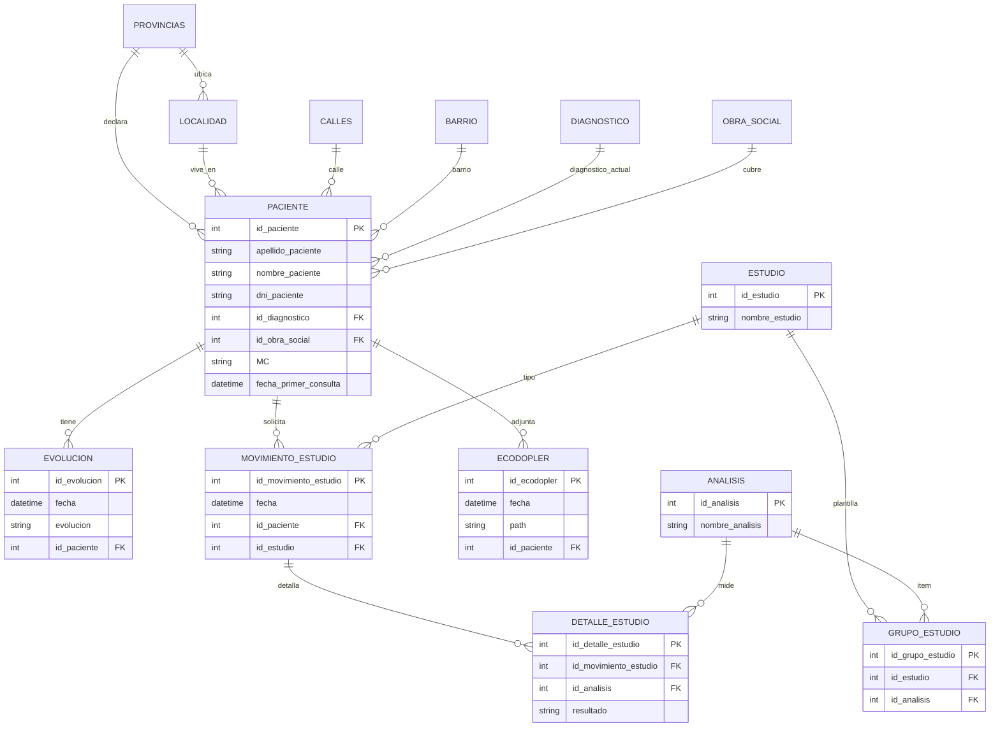

# Análisis del sistema legacy Consultorios

**Fecha:** 2026-10-22  
**Alcance:** Fase 0 / Paso 2 — solo lectura del código en `D:\VBNetAnterior\Consultorios`  
**Nota de privacidad:** no se copiaron ni citaron datos de pacientes, profesionales ni clínicas. Los archivos `.mdf` / `.ldf` del árbol **no se abrieron**. Connection strings y credenciales no se reproducen. Nombres de clínicas o médicos, si aparecieran, se reemplazan por `ClinicaA` / `ProfesionalA`.

---

## a. Resumen ejecutivo

**Consultorios** es un sistema de escritorio de **historias clínicas** que desarrollé en Ingesoft. Cubre ficha de paciente, anamnesis en la misma ficha, evoluciones, una línea de tiempo de historia clínica (calculada), pedidos de estudio con resultados, un adjunto tipo ecodoppler (ruta a `.doc`) y catálogos (diagnóstico, obra social, estudios, análisis, geografía).

| Aspecto | Hallazgo |
|---------|----------|
| Plataforma | VB.NET **WinForms**, solución Visual Studio 2010 (`Consultorios.sln`) |
| Framework | **.NET Framework 2.0** (`TargetFrameworkVersion=v2.0`; el `.vbproj` aún muestra ProductVersion 8.0.50727 / VS 2005) |
| Base de datos | **SQL Server Express** local; catálogo `Maestro_consultorio` (el typed DataSet usa el nombre `Maestro_Consultorio`) |
| Acceso a datos | `System.Data.SqlClient` + clases `cls*` (el tipo se llama sin prefijo: `Paciente`, `Evolucion`, …). Insert/delete y listados vía stored procedures; update vía `SqlCommandBuilder`; algunos `SELECT` concatenados |
| Reportes | **Crystal Reports** 13.0.2000.0 (3 `.rpt`) + **ReportViewer** 8 (`Report1.rdlc`, no usado por el flujo principal) |
| Autenticación de app | **Ninguna.** Quien ejecuta el EXE y llega a SQL con Windows Integrated ve todos los pacientes |
| Multi-clínica / profesional | **No existe.** Una base local, sin entidad de consultorio ni de profesional |
| Agenda / turnos | **No existe** en este árbol |
| Recetas | **No existen** |
| Facturación | **No existe** en la app clínica (obra social es un dato de ficha) |

**Arquitectura de capas (de facto):**

1. **Formularios** (`frm*`) — UI + orquestación + parte de reglas.
2. **Clases de datos** (`cls*.vb`) — `DataTable` / `DataAdapter` por tabla.
3. **`Conexion` + `Inicio`** — cadena hardcodeada e instancias globales (`oPaciente`, `oEvolucion`, …).
4. Carpetas vacías `Clase\` y `Entidad\` (se empezó un corte tipo Pymen y no se usó).

No hay dominio separado, ni auditoría, ni tenant.

---

## b. Inventario de módulos

Complejidad según volumen de formularios y acoplamiento. El menú real es el dashboard de `frmInicio` (botones, sin `MenuStrip`).

| Módulo | Propósito | Formularios principales | Tablas | Complejidad | En home |
|--------|-----------|-------------------------|--------|-------------|---------|
| **Pacientes** | ABM de ficha + anamnesis | `frmAbmPaciente`, `frmDetallePaciente` | `PACIENTE` (21 columnas en código; 17 en script de creación) | Media | Sí |
| **Historia clínica** | Línea de tiempo **calculada** (no es una tabla) | `frmAbmHistoriaClinica` | `sp_Generar_HC` une evoluciones + estudios + análisis + ecodoppler | Media | Sí |
| **Evoluciones** | Notas de evolución por paciente | `frmAbmEvolucion`, `frmDetalleEvolucion` | `EVOLUCION` (4 columnas) | Baja | No (se abre desde paciente) |
| **Estudios** | Pedido de estudio + resultados | `frmAbmMovimiento_Estudio`, `frmAbmMovimiento_estudio_directo`, `frmDetalleMovimiento_Estudio`, `frmAbmDetalle_estudio`, `frmDetalleDetalle_estudio` | `MOVIMIENTO_ESTUDIO`, `DETALLE_ESTUDIO` | Media–Alta | Sí (pedidos globales) |
| **Catálogo de estudios / análisis** | Tipos de estudio y ítems de análisis; plantilla `GRUPO_ESTUDIO` | `frmAbmEstudio`, `frmDetalleEstudio`, `frmAbmAnalisis`, `frmDetalleAnalisis` | `ESTUDIO`, `ANALISIS`, `GRUPO_ESTUDIO` | Baja | No |
| **Diagnóstico** | Catálogo; se asigna **un** diagnóstico a la ficha | `frmAbmDiagnostico`, `frmDetalleDiagnostico` | `DIAGNOSTICO` | Baja | Sí |
| **Obra social** | Catálogo; se asigna **una** OS + nro. de afiliado en ficha | `frmAbmObraSocial`, `frmDetalleObraSocial` | `OBRA_SOCIAL` | Baja | Sí |
| **Ecodoppler** | Adjunta un `.doc` local (guarda `path` / `archivo`) | `frmAbmEcodopler`, `frmDetalleEcodopler` | `ECODOPLER` | Baja | No (desde paciente) |
| **Geografía** | Provincia / localidad / calle / barrio | `frmAbmLocalidad`, `frmAbmCalle`, `frmAbmBarrio` + detalles | `PROVINCIAS`, `LOCALIDAD`, `CALLES`, `BARRIO` | Baja | No (desde ficha) |
| **Reportes** | Crystal viewer | `Frmreporte` | Datasets armados en memoria | Baja | No (imprimir desde ficha / HC / pedido) |
| **Consulta genérica** | Grilla reutilizable | `frmConsulta` | `odtConsultaGeneral` | Baja (y con restos de otro sistema) | No |

### Ausentes (buscados y no hallados en el proyecto compilado)

- Agenda / turnos / citas / horarios de consultorio.
- Recetas / prescripciones.
- Facturación, cobros, liquidación a obras sociales.
- Entidad profesional / usuario / rol / login.
- Auditoría de quién vio o modificó la historia clínica.

### Ruido en el árbol (no es Consultorios)

El directorio legacy **también contiene** una copia de otro producto (`Gestion_Agro`, ~360 `.vb` / ~125k LOC) y forms de sueldos / subalmacenes **compilados** en `Consultorios.vbproj` pero **no alcanzables** desde `frmInicio`. Carpetas `Backup`, `old`, `Archivos de copia de seguridad de Crystal Reports`, `bin`, `obj`. Eso no forma parte del producto clínico. No se detalla.

---

## c. Modelo de datos

Esquema inferido de `cls*` y confirmado con `Consultas/CREAR_TABLAS.sql` (script de recreación, sin datos reales). Hay **drift**: el código de `Paciente` y `Ecodopler` tiene columnas que el script no crea.

**14 tablas clínicas.** No hay tabla `HistoriaClinica`: la HC es un `UNION` temporal.

| Tabla | PK | Columnas (estructura) | FKs |
|-------|-----|------------------------|-----|
| `PACIENTE` | `id_paciente` | En código: **21** (`apellido`, `nombre`, `dni`, dirección, `telefono`, `id_diagnostico`, `id_obra_social`, textos `MC`/`AEA`/`APP`/`AF`/`EF`/`AH`, `afiliado_os`, `departamento`, `fecha_primer_consulta`). El script de creación trae **17** (sin `AH`, `afiliado_os`, `departamento`, `fecha_primer_consulta`) | provincia, localidad, calle, barrio, diagnóstico, obra social |
| `EVOLUCION` | `id_evolucion` | **4**: fecha, texto `evolucion` (**varchar 200**), `id_paciente` | paciente |
| `ESTUDIO` | `id_estudio` | **3**: nombre, detalle | — |
| `ANALISIS` | `id_analisis` | **3**: nombre, detalle | — |
| `GRUPO_ESTUDIO` | `id_grupo_estudio` | **3**: `id_estudio`, `id_analisis` (plantilla de ítems por tipo de estudio) | estudio, análisis |
| `MOVIMIENTO_ESTUDIO` | `id_movimiento_estudio` | **4**: fecha, `id_paciente`, `id_estudio` | paciente, estudio |
| `DETALLE_ESTUDIO` | `id_detalle_estudio` | **4**: movimiento, análisis, `resultado` (hasta 300) | movimiento, análisis |
| `ECODOPLER` | `id_ecodopler` | Script: fecha, `path`, `id_paciente`. Código: agrega `archivo` | paciente |
| `DIAGNOSTICO` | `id_diagnostico` | **3**: nombre, detalle. El id `1` no se puede editar (semilla `NINGUNO`) | — |
| `OBRA_SOCIAL` | `id_obra_social` | **3**: nombre, detalle. Id `1` = `NINGUNO` | — |
| `PROVINCIAS` | `id_provincia` | **2** | — |
| `LOCALIDAD` | `id_localidad` | **5**: nombre, CP, característica, `id_provincia` | provincia |
| `CALLES` | `id_calle` | **2** | — (sin FK a localidad) |
| `BARRIO` | `id_barrio` | **2** | — (sin FK a localidad) |

La anamnesis (`MC`, `AEA`, `APP`, `AF`, `EF`, `AH`) vive **en la fila del paciente**, no como documentos de HC. Las etiquetas de UI son solo las siglas (`M - C :`, `A - E - A :`, …). El significado clínico exacto queda en preguntas abiertas.

### Diagrama ER

### Stored procedures

~**80** nombres `sp_*` referenciados en las `cls*` clínicas (patrón `Insert` / `Delete` / `Find` / `GetAll` / `Check` por tabla, más `sp_Paciente_Find_Dni`, `sp_Paciente_GetAll_Cmb`, `sp_Paciente_GetOne`, `sp_Evolucion_GetAll_HC`, `sp_Generar_HC`, `sp_Generar_HC_print`, `sp_Movimiento_estudio_GetSome`, `sp_Detalle_estudio_Get`, `sp_Grupo_estudio_GetAll_Paciente`, `sp_Analisis_Find_Id`). También hay SPs sin prefijo `sp_` (`ConsultarPaciente`, `ConsultarEvolucion`, etc.).

Los **cuerpos** no están versionados en el repo salvo el borrador `Consultas/GENERAR HC.sql`: arma tablas temporales, une `EVOLUCION` + `MOVIMIENTO_ESTUDIO`/`ESTUDIO` + `ECODOPLER` + `DETALLE_ESTUDIO`/`ANALISIS` y devuelve `FECHA`, `TIPO`, `DETALLE`, `RESULTADO`.

---

## d. Flujos principales

Modo de los ABM: enteros globales en `Inicio.vb` (`Bandera*`: 1 = alta, 2 = edición, 3 = consulta).

### Paciente

1. Home → `frmAbmPaciente` → grilla `sp_Paciente_GetAll`.
2. Filtro por apellido (`Buscar`) o DNI (`BuscarDni`).
3. Alta/edición en `frmDetallePaciente`: combos de geografía, diagnóstico y obra social (se pueden abrir ABMs hijos). Validación débil: el nombre no puede quedar vacío; el resto de FKs se asume cargado.
4. Desde la grilla: evolución, HC, ecodoppler, pedido de estudio “directo”.
5. Impresión: `Bandera_print = 1` → `Detalle_Paciente.rpt`.

### Evolución

1. Solo desde un paciente seleccionado (`lblidPaciente <> 0`).
2. `frmAbmEvolucion` lista `ConsultarTodo` filtrado por ese paciente.
3. El detalle guarda fecha + texto libre + `id_paciente`. **No** guarda profesional, diagnóstico de la nota ni firma.
4. Tope de persistencia: **200 caracteres**.

### Historia clínica

1. Home (cualquier paciente + rango de fechas) o desde ficha (paciente fijo, fecha inicio = `fecha_primer_consulta`).
2. `btnConsultar` llama `oEvolucion.GenerarHistoriaClinica` → `sp_Generar_HC`.
3. Grilla: `FECHA` / `TIPO` / `DETALLE` / `RESULTADO`. Si `TIPO = ECODOPPLER`, el doble clic hace `Process.Start` de la ruta.
4. Impresión: `Bandera_print = 2` → `Historia_Clinica.rpt` (`sp_Generar_HC_print`).
5. El botón “buscar paciente” del form está oculto y **sin handler**.

### Estudios

1. Home: pedidos de todos los pacientes. Desde ficha: el mismo flujo trabado al paciente (`BanderaMovimiento_Estudio` 11/22).
2. El detalle arma el pedido: tipo de estudio → carga análisis default (`Grupo_estudio`) → el usuario mueve ítems a la lista del pedido → guarda cabecera + un `DETALLE_ESTUDIO` por análisis.
3. Resultados: doble clic del movimiento → `frmAbmDetalle_estudio` → detalle con `resultado`.
4. Impresión del pedido: `Pedido_Estudio.rpt`.

### Obra social

Catálogo + un FK en la ficha + `afiliado_os`. No hay liquidación, coseguro ni facturación.

---

## e. Seguridad actual

| Tema | Estado |
|------|--------|
| Login de aplicación | No hay. `AuthenticationMode = 0` (Windows) es la identidad del host VB, no un usuario clínico |
| Contraseñas | No hay tabla ni hash de usuarios en el proyecto compilado. SQL usa **Trusted_Connection / Integrated Security** (cuenta de Windows del operador) |
| Roles / permisos | No hay. Todos los botones del dashboard están habilitados |
| Tenant / clínica | No hay |
| Auditoría de HC | No hay (ni lectura ni escritura) |
| Inyección SQL | Varios `SELECT * FROM … WHERE id = ` & id concatenados en las `cls*` |
| Adjuntos | Ruta de filesystem abierta con `Process.Start` |
| Secretos en código | Servidor y nombre de base **hardcodeados** en `Conexion.vb` y `app.config`. No hay password SQL en esas cadenas |
| Firma ClickOnce | `Consultorios_TemporaryKey.pfx` en el árbol (no se copió) |

Cualquier persona con el EXE y un Windows que autentique contra esa instancia local tiene **CRUD completo** sobre todas las fichas.

---

## f. Tamaño

Medido sobre el **root compilado** (sin `Gestion_Agro`, `Backup`, `bin`, `obj`).

| Métrica | Valor |
|---------|-------|
| Archivos `.vb` en root | 90 |
| LOC root (líneas no vacías aprox.) | ~18.3k |
| LOC clínico (sin leftovers compilados ni DataSet generado) | ~13.8k |
| LOC leftovers compilados (sueldos, subalmacenes, `PRUEBA`, DataSet) | ~4.6k |
| Formularios compilados (`SubType=Form`) | 34 (incluye 4 leftovers + `PRUEBA`) |
| Formularios clínicos alcanzables | ~29 |
| Clases `cls*` clínicas | 14 |
| Reportes Crystal | 3 (`Detalle_Paciente.rpt`, `Historia_Clinica.rpt`, `Pedido_Estudio.rpt`) |
| RDLC | 1 (`Report1.rdlc`) |
| Stored procedures `sp_*` referenciados | ~80 |
| Tablas del script de creación | 14 |

El árbol completo es mucho más grande por `Gestion_Agro` y backups: **no cuenta** como tamaño del producto a modernizar.

---

## g. Problemas técnicos y riesgos

1. **Software de salud sin control de acceso ni auditoría.** Incumple, a nivel de diseño, lo que piden la Ley 26.529 (historia clínica, acceso, integridad) y la Ley 25.326 (datos personales sensibles). Quien sienta el EXE ve todo.
2. **Sin profesional firmante.** La evolución y la HC no registran quién las escribió. La 26.529 exige identificación del profesional interviniente.
3. **Anamnesis denormalizada y tope de 200 caracteres** en evolución y en los textos `MC`/`AEA`/… Poco realista para una HC usable.
4. **HC calculada en SQL** (`##TEMPORAL`) con cuerpo apenas versionado. Difícil de testear y de migrar 1:1 sin la BD real.
5. **Drift de esquema** entre `CREAR_TABLAS.sql` y las `cls*` (columnas extra en paciente y ecodoppler). No se inspeccionó el `.mdf`.
6. **SQL concatenado** + `SqlCommandBuilder` + estado global (`Bandera*`, `oPaciente` singleton). Carreras si se abrieran dos fichas; hoy es single-user de hecho.
7. **.NET 2.0 + Crystal 13 + WinForms.** Sin camino de upgrade in-place razonable.
8. **Archivos de base (`.mdf` / `.ldf`) y `.pfx` dentro del árbol legacy.** Riesgo de copiar PII o claves si alguien hace un zip del folder. Este repo no los toca.
9. **Script `Consultas/BORRAR TODAS LAS TABLAS.sql`.** Destructivo; convive con el código.
10. **Contaminación con otro producto** (`Gestion_Agro`, forms de sueldo/subalmacén, tooltips que dicen “empleado”, `frmConsulta` con labels agro). Confunde el inventario.
11. **Adjuntos por path local.** Si se mueve el PC, los `.doc` se rompen; no hay control de malware ni de acceso.
12. **Calle y barrio sin FK a localidad.** Combos independientes; datos sucios posibles.
13. **Un diagnóstico y una OS por paciente.** No hay historial de cobertura ni de diagnósticos.
14. **Help HTML y reportes resueltos recortando `\bin` del `CurrentDirectory`.** Frágil fuera de Visual Studio.

---

## h. Preguntas abiertas

Van a `docs/legacy/owner-decisions.md`. No se adivina comportamiento de negocio ni alcance de migración.

---

## i. Qué no se hizo

- No se abrió SQL Server ni el `.mdf`.
- No se ejecutó la app.
- No se copió ningún archivo del legacy a este repo.
- No se escribió código de la aplicación nueva.
